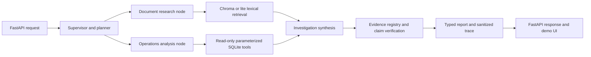

# AEGIS - AI Evidence-Grounded Intelligence System

[](https://github.com/itsmyfacade/RAG-AI-Evidence-Grounded-Intelligence-System/actions/workflows/ci.yml)

AEGIS is an incident-investigation application for tracing technical failures across documentation and structured operational evidence. I built it to demonstrate a practical RAG system that makes citations, uncertainty, and missing evidence visible instead of presenting an unsupported model answer as a root-cause certification.

## Live demo

[Open the AEGIS demo](https://aegis-ai-y41k.onrender.com/demo/)

The public demo uses `AEGIS_DEPLOYMENT_PROFILE=lite` and `AEGIS_LLM=local`. It is deterministic and uses lightweight lexical retrieval so it can run within Render Free's 512 MB memory limit. The live demo is not using Bedrock inference.

## Architecture



An investigation request passes through one bounded, sequential LangGraph workflow: a supervisor selects the work, document research retrieves technical passages, operations analysis queries SQLite, synthesis uses the configured provider, and verification validates evidence identity and claim support. The research and verification stages are deterministic workflow nodes; only the configured synthesis provider performs model inference. The system distinguishes observations, hypotheses, documented causes, and operational confirmation.

## Technology and data

- Python, Pydantic, FastAPI, and Uvicorn
- LangChain document, embedding, and provider abstractions
- LangGraph supervisor, bounded routing, retries, and shared state
- Chroma with Sentence Transformers for full local semantic retrieval
- SQLite for logs, deployments, configuration, tickets, and webhook events
- AWS Bedrock Runtime through Boto3 and LangChain `ChatBedrockConverse`
- Gemini provider adapter for explicit operator-selected inference
- Docker and GitHub Actions

The deterministic generator creates 20 linked synthetic scenarios with partners, incidents, support tickets, deployments, configuration changes, API logs, webhook events, and technical documents. The baseline database contains 240 API log records, 80 webhook events, 20 records in the main scenario tables, and 30 cataloged narrative documents. Operational logs remain structured in SQLite rather than being indiscriminately embedded. Serving SQLite contains operational facts only; evaluator answers live separately in `data/evaluation/scenario_labels.json` and are never loaded by the API or graph.

## Retrieval modes

### Standard local vector RAG

The standard profile uses `all-MiniLM-L6-v2` Sentence Transformer embeddings with 384 dimensions and a persisted Chroma collection named `aegis_incidents` in `.chroma_local`. Chunks use a 500-character target and 80-character overlap. The small deterministic corpus is rebuilt safely so changed and deleted chunks are reconciled.

Five-case synthetic evaluation:

| Metric | Lite lexical | Standard vector |
| --- | ---: | ---: |
| Recall@4 | 0.5667 | 1.0000 |
| Hit@4 | 0.8000 | 1.0000 |
| MRR | 0.7000 | 1.0000 |
| Evidence coverage | 0.8333 | 1.0000 |

These are regression measurements on five labeled synthetic retrieval cases, not
production benchmark results or diagnosis-accuracy measurements. Lite results
are produced with `AEGIS_DEPLOYMENT_PROFILE=lite` and lexical retrieval. Standard
results are produced with `AEGIS_DEPLOYMENT_PROFILE=standard`, the local
`all-MiniLM-L6-v2` model, and a freshly built Chroma index. The evaluation script
computes Recall@4, Hit@4, MRR, and evidence coverage from
`data/evaluation/retrieval_cases.json`:

```powershell
$env:AEGIS_DEPLOYMENT_PROFILE="lite"
python -m src.retrieval_eval --k 4

$env:AEGIS_DEPLOYMENT_PROFILE="standard"
$env:AEGIS_EMBEDDINGS="local"
$env:AEGIS_EMBEDDING_LOCAL_FILES_ONLY="true"
python -m src.rag
python -m src.retrieval_eval --k 4
```

### Hosted lite mode

The lite profile loads the small JSON document corpus directly, ranks lexical overlap, and preserves canonical metadata and evidence validation. It does not import Torch, Sentence Transformers, Chroma, or `langchain_chroma`. It reports `retrieval_mode=lexical`; it is not presented as embedding-quality retrieval.

## Local setup

Use Python 3.12 for the canonical CI and Docker runtime. Full local vector RAG requires the pinned dependencies and a locally available embedding model.

```powershell
git clone https://github.com/itsmyfacade/RAG-AI-Evidence-Grounded-Intelligence-System.git
Set-Location "RAG-AI-Evidence-Grounded-Intelligence-System"
py -3.12 -m venv .venv
.\.venv\Scripts\Activate.ps1
python -m pip install -r requirements.txt
Copy-Item .env.example .env
python generate_data.py
```

For a low-memory local run:

```powershell
$env:AEGIS_DEPLOYMENT_PROFILE="lite"
$env:AEGIS_LLM="local"
$env:AEGIS_EMBEDDINGS="local"
python -m uvicorn src.api:app --reload
```

For full local vector retrieval:

```powershell
$env:AEGIS_DEPLOYMENT_PROFILE="standard"
$env:AEGIS_LLM="local"
$env:AEGIS_EMBEDDINGS="local"
$env:AEGIS_EMBEDDING_MODEL="all-MiniLM-L6-v2"
$env:AEGIS_EMBEDDING_LOCAL_FILES_ONLY="true"
python -m src.rag
python -m src.retrieval_eval
python -m uvicorn src.api:app --reload
```

If the embedding model is not cached, download it once in an environment with Hugging Face access, then rerun with `AEGIS_EMBEDDING_LOCAL_FILES_ONLY=true`.

## API and demo

- `GET /health` - process health
- `GET /ready` - data and active-profile readiness
- `GET /samples` - allowlisted synthetic scenarios
- `POST /investigate` - structured investigation report
- `GET /demo/` - frontend investigation interface

Example request (the demo supplies a symptom-oriented question):

```powershell
$body = @{ scenario_id = "SCN-005"; question = "Investigate repeated webhook deliveries and duplicate downstream records. Do not assume a root cause." } | ConvertTo-Json
Invoke-RestMethod -Method Post -Uri "http://127.0.0.1:8000/investigate" -ContentType "application/json" -Body $body
```

Reports include status, summary, findings, evidence references and excerpts, hypotheses, evidence gaps, contradictions, provider identity, retrieval mode, token usage where available, and a sanitized agent trace. The API applies bounded concurrency, request quotas, input validation, and safe public errors.

## Providers and AWS boundary

`AEGIS_LLM=local` uses deterministic synthesis for tests and demonstrations; it is not LLM inference. `AEGIS_LLM=bedrock` selects the real Bedrock provider explicitly. The verified local Bedrock configuration uses region `us-east-2` and inference profile `us.amazon.nova-micro-v1:0` through `ChatBedrockConverse`. Provider identity is preserved and failures do not silently fall back to local output.

The hosted Render demo remains local-only and does not require AWS credentials. S3 synchronization, IAM examples, Bedrock diagnostics, AgentCore packaging guidance, and GovCloud design notes are available in `docs/`. No AWS resources are provisioned by this repository.

## Tests and CI

Normal tests are offline and do not call Bedrock, Gemini, S3, IAM, or Hugging Face. Python 3.12 in GitHub Actions and Docker is the compatibility baseline. Standard vector retrieval is tested separately from the lite CI path because it requires a locally cached embedding model; the hosted demo does not require that model.

```powershell
python -m compileall -q src tests generate_data.py aws_diagnostic.py
python -m pytest tests -q
python -m ruff check src tests generate_data.py aws_diagnostic.py --select E4,E7,E9,F
node --check frontend/app.js
```

The full scenario evaluator is separate from serving behavior and uses the same symptom-oriented question builder as the demo:

```powershell
$env:AEGIS_LLM="local"
$env:AEGIS_DEPLOYMENT_PROFILE="lite"
python -m src.scenario_eval
```

The evaluator compares evidence-derived runtime statuses with held-out labels; any match rate is a synthetic consistency check, not a diagnosis-accuracy benchmark. Expected labels are never loaded by the serving API or graph.

GitHub Actions uses Python 3.12, the pinned full dependency manifest, offline/local environment variables, compilation, pytest, Ruff, and frontend syntax validation. Remote workflow success should be confirmed in GitHub; local results do not prove a remote run passed.

## Security and limitations

- `.env`, credentials, databases, Chroma indexes, caches, archives, and virtual environments are ignored from source control.
- SQL tools are read-only and parameterized.
- S3 synchronization resolves object keys inside the configured directory and rejects traversal or absolute paths.
- Documents are treated as untrusted evidence, not instructions.
- Citation identity checks are deterministic; claim-support checks are conservative heuristics, not calibrated entailment or hallucination prevention.
- The dataset and five-case retrieval evaluation are synthetic and small.
- A documented cause is not automatically an operationally confirmed root cause.
- The demo is not authenticated and relies on in-process quotas; production use would require stronger identity, rate limiting, durable storage, monitoring, and secret management.
- Standard Sentence Transformer and Chroma mode is not suitable for a 512 MB hosted instance.

AEGIS is an engineering demonstration, not a production incident-management system or production root-cause certification service.

## Project guides

- [`docs/DEPLOYMENT.md`](docs/DEPLOYMENT.md) - Docker and Render deployment boundaries
- [`docs/HANDS_ON.md`](docs/HANDS_ON.md) - interview-oriented verification exercises
- [`docs/DOMAIN_ONTOLOGY.md`](docs/DOMAIN_ONTOLOGY.md) - lightweight data relationships
- [`docs/AGENTCORE.md`](docs/AGENTCORE.md) - optional AgentCore compatibility guidance
- [`docs/GOVCLOUD.md`](docs/GOVCLOUD.md) - GovCloud architecture considerations