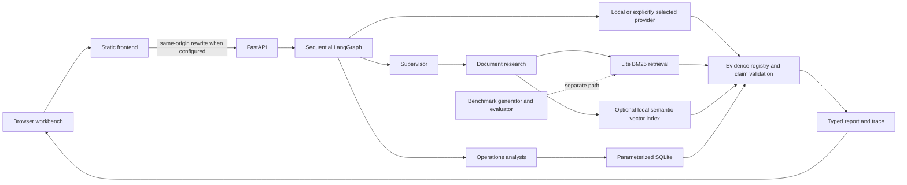

# AEGIS: Evidence-Grounded AI Investigation System

[](https://github.com/itsmyfacade/RAG-AI-Evidence-Grounded-Intelligence-System/actions/workflows/ci.yml)

AEGIS is an evidence-grounded technical investigation workbench. It correlates synthetic incident documentation with structured operational records, runs a bounded sequential LangGraph workflow, and returns findings with citations, evidence gaps, contradictions, uncertainty, and an inspectable execution trace. Evidence grounding makes the reasoning traceable to available sources; it does not guarantee factual correctness or certify a production root cause.

## Live demo

[Open the existing AEGIS Render demo](https://aegis-ai-y41k.onrender.com/demo/)

The existing public URL remains the backward-compatible showcase. Its hosted profile uses deterministic local synthesis and the lightweight retrieval path. Render Free may suspend the service between requests, so the first request can experience a cold start. No Vercel deployment is claimed or created by this repository.

The workbench exposes **20 interactive investigation scenarios** from `GET /samples`. These are executable demonstration contexts, not benchmark questions. The separate Validation workspace reads a **1,200-case synthetic retrieval benchmark** over **90 evidence documents**. A separate **40-case ground-truth review packet** is available for independent review and remains pending; it is not part of serving data.

## Why AEGIS

Many AI investigation interfaces make a plausible answer look like a confirmed root cause. AEGIS is designed to show the boundary between what a source says, what operational records demonstrate, what remains a hypothesis, and what evidence is missing.

## Interactive scenarios versus benchmark cases

| Surface | Dataset | Purpose |
| --- | --- | --- |
| Investigation workbench | 20 interactive scenarios from `/samples` | Run a bounded investigation and inspect findings, evidence, uncertainty, and the actual workflow trace. |
| Validation workspace | 1,200 synthetic retrieval cases | Compare retrieval profiles using fixed labels and versioned benchmark artifacts. |
| Human-review workspace | 40 review-packet cases | Let a reviewer inspect labels and export separate decisions. Independent review is pending. |

The three surfaces answer different questions. Interactive scenarios exercise the application flow. Benchmark cases measure retrieval behavior. Review-packet cases support label inspection. They must not be presented as interchangeable counts.

## Implemented capabilities

- FastAPI request validation, safe public errors, bounded concurrency, and in-process demo quotas.
- Sequential LangGraph workflow: supervisor, document research, operations analysis, investigation synthesis, and evidence validation.
- Lite retrieval using cached deterministic BM25-style lexical ranking.
- Legacy lexical profile retained for historical comparisons.
- Optional local Sentence Transformer retrieval profile with a small file-backed semantic vector index.
- Read-only parameterized SQLite operational evidence tools.
- Citation identity validation and conservative lexical claim-support checks.
- Explicit evidence gaps, contradictions, hypotheses, findings, provider identity, and retrieval mode.
- Human-review packet workflow with separate JSON decision export.
- Benchmark dashboard with artifact provenance and baseline versus optimized metrics.
- Clearly labeled deterministic recorded fallback for backend cold starts.
- Static frontend deployment preparation through Vercel rewrites to the unchanged Render API.

## Architecture



The serving graph never loads evaluator labels. Benchmark generation and review tooling are local evaluation paths, separate from the application workflow.

More detail is in [`docs/ARCHITECTURE.md`](docs/ARCHITECTURE.md).

## Investigation workflow

1. Select a synthetic scenario or write a symptom-oriented question.
2. Submit the bounded investigation request.
3. Review the status, provider, retrieval mode, and findings.
4. Inspect evidence records, source IDs, excerpts, supporting references, gaps, and contradictions.
5. Open the workflow timeline to inspect the actual sequential execution trace.
6. Treat documented causes and hypotheses as evidence-qualified statements, not production certification.

The interface distinguishes live API output, benchmark artifacts, and recorded deterministic local output.

## Evaluation results

The Phase 3 comparison uses the same 1,200-case synthetic workload and 90-document synthetic corpus for both profiles.

| Metric | Legacy lexical | BM25 plus abstention | Change |
| --- | ---: | ---: | ---: |
| Recall@5 | 0.6315 | 0.8375 | +32.6% relative |
| MRR | 0.5104 | 0.8559 | +67.7% relative |
| nDCG@5 | 0.5285 | 0.8462 | +60.2% relative |
| Evidence coverage | 0.7144 | 0.8426 | +17.9% relative |
| Correct retrieval-level abstention | 0.0000 | 0.2333 | +23.3 percentage points |
| False-answer proxy | 1.0000 | 0.7667 | -23.3% relative |

Relative change is `(optimized - legacy) / legacy`. Abstention is reported in percentage points because its legacy baseline is zero, so a relative percentage would be undefined.

The optimized local retrieval p95 was 2.585 ms. The legacy profile measured 1.422 ms p95 under the same local harness. The optimized profile trades a small latency increase for stronger ranking quality.

These are synthetic retrieval measurements, not production accuracy, diagnosis accuracy, semantic entailment, or hallucination-prevention claims. The benchmark has evidence-family reuse across splits, ambiguous-case abstention remains weak, and the 40-case review packet has not received independent human decisions. Citation identity checks do not prove semantic entailment, and retrieval-level false-answer proxies do not measure final-answer hallucination. Confidence intervals, checksums, methodology, and exact commands are documented in [`docs/PHASE3_RELEASE_EVIDENCE.md`](docs/PHASE3_RELEASE_EVIDENCE.md).

## Evaluation integrity

- Dataset version: `aegis-phase2-v1`.
- Generator version: `template-ontology-v1`.
- Splits: development 700, validation 200, held-out 300.
- Correct abstention is a retrieval-level proxy, not final answer correctness.
- Citation identity is separate from semantic claim support.
- The current 40-case human-review packet remains pending independent review.
- Evidence families are reused across splits, so full family-disjoint independence is not claimed.
- Mixed-source retrieval and ambiguous-case abstention remain known weaknesses.

The review workflow is available at `/demo/review.html` when running the local static mount. Load `data/evaluation/results/phase3-ground-truth-review-packet.json` through the file picker, record decisions after independent inspection, and export the separate decision JSON.

## Local setup

Use Python 3.12 for the canonical CI and Docker runtime.

```powershell
git clone https://github.com/itsmyfacade/RAG-AI-Evidence-Grounded-Intelligence-System.git
Set-Location "RAG-AI-Evidence-Grounded-Intelligence-System"
py -3.12 -m venv .venv
.\.venv\Scripts\Activate.ps1
python -m pip install -r requirements.txt
Copy-Item .env.example .env
python generate_data.py --mode all
```

Low-memory deterministic local run:

```powershell
$env:AEGIS_DEPLOYMENT_PROFILE="lite"
$env:AEGIS_LLM="local"
$env:AEGIS_EMBEDDINGS="local"
$env:AEGIS_RETRIEVAL_PROFILE="bm25"
$env:AEGIS_RETRIEVAL_ABSTENTION="true"
$env:AEGIS_RETRIEVAL_ABSTENTION_THRESHOLD="12"
python -m uvicorn src.api:app --reload
```

Open [http://127.0.0.1:8000/demo/](http://127.0.0.1:8000/demo/).

The existing Render demo uses the same relative API paths. The prepared Vercel configuration is in [`frontend/vercel.json`](frontend/vercel.json), but no Vercel deployment is claimed.

## Repository structure

```text
src/                 FastAPI routes, workflow, retrieval, evidence, and settings
data/                Synthetic source data, SQLite evidence, and local evaluation outputs
frontend/             Static workbench, review workspace, benchmark artifacts, and Vercel config
tests/                Python contracts, regression checks, and Playwright browser tests
tools/                Benchmark, profiling, review, and validation utilities
docs/                 Architecture, deployment, case-study, and evaluation evidence
```

The benchmark runtime results directory is intentionally ignored. The committed evaluation evidence document contains the reproducibility details needed to regenerate those artifacts locally.

## API

- `GET /health`: process health.
- `GET /ready`: profile and data readiness.
- `GET /samples`: allowlisted synthetic scenarios.
- `POST /investigate`: typed investigation response.
- `GET /demo/`: static workbench.

Example request:

```powershell
$body = @{ scenario_id = "SCN-005"; question = "Investigate webhook processing errors, delayed deliveries, and delivery attempts for a partner integration. Do not assume a root cause." } | ConvertTo-Json
Invoke-RestMethod -Method Post -Uri "http://127.0.0.1:8000/investigate" -ContentType "application/json" -Body $body
```

## Retrieval profiles

### Lite

The lite profile reads the small JSON document corpus directly and uses cached BM25-style lexical ranking. It does not import Torch or Sentence Transformers. Set `AEGIS_RETRIEVAL_PROFILE=legacy` to reproduce the historical raw lexical baseline. Set `AEGIS_RETRIEVAL_ABSTENTION=true` to enable the calibrated evidence score gate.

### Standard

The optional standard profile uses `all-MiniLM-L6-v2` embeddings with a small local JSON vector index. It preserves document IDs, metadata equality filters, cosine-similarity ranking, and offline persistence without a vector database service. It requires the optional dependency set and locally available model files. It is not the hosted profile.

## Data generation

`generate_data.py` is the canonical generator for the deterministic 30-document narrative corpus and SQLite dataset.

```powershell
python generate_data.py --mode documents
python generate_data.py --mode database
python generate_data.py --mode all
python generate_data.py --mode validate
```

Phase 2 and Phase 3 benchmark cases and runtime results are generated locally under `data/evaluation/results/`, which is ignored. The committed evidence summary is [`docs/PHASE3_RELEASE_EVIDENCE.md`](docs/PHASE3_RELEASE_EVIDENCE.md).

## Testing and reproducibility

```powershell
python -m compileall -q src tests tools generate_data.py aws_diagnostic.py bedrock_smoke.py mantle_smoke.py
python -m pytest -q
python -m ruff check src tests tools generate_data.py aws_diagnostic.py bedrock_smoke.py mantle_smoke.py
node --check frontend/app.js
node --check frontend/review.js
git diff --check
```

Historical five-case retrieval baseline:

```powershell
$env:AEGIS_DEPLOYMENT_PROFILE="lite"
$env:AEGIS_RETRIEVAL_PROFILE="legacy"
$env:AEGIS_RETRIEVAL_ABSTENTION="false"
python -m src.retrieval_eval --k 4
```

Phase 3 optimized benchmark:

```powershell
$env:AEGIS_DEPLOYMENT_PROFILE="lite"
$env:AEGIS_LLM="local"
$env:AEGIS_EMBEDDINGS="local"
$env:AEGIS_EMBEDDING_LOCAL_FILES_ONLY="true"
$env:AEGIS_RETRIEVAL_PROFILE="bm25"
$env:AEGIS_RETRIEVAL_ABSTENTION="true"
$env:AEGIS_RETRIEVAL_ABSTENTION_THRESHOLD="12"
python tools/run_phase2_benchmark.py
```

The full browser suite is available through Playwright:

```powershell
npm ci
npx playwright install chromium
npm run test:e2e
```

GitHub Actions runs lightweight Python quality, API, frontend syntax, browser, and standard-profile security-gate jobs. Heavy benchmark reproduction remains a documented local command rather than a required per-push job.

The latest local release-preflight validation recorded **88 Python tests passed**, **9 Playwright browser tests passed**, Ruff passed, Python compilation passed, JavaScript syntax checks passed, benchmark, recorded-demo, and Vercel JSON validation passed, and `npm audit --audit-level=high` reported **0 vulnerabilities**. These checks establish local regression evidence; they do not guarantee public Render reliability.

## Docker and Render

The Dockerfile builds the lightweight FastAPI backend profile. It does not Dockerize the static frontend. Render remains the existing backend and demo host. The current public URL is preserved:

`https://aegis-ai-y41k.onrender.com/demo/`

Docker and Render boundaries are documented in [`docs/DEPLOYMENT.md`](docs/DEPLOYMENT.md). No new service, paid resource, or deployment is created by this repository.

The intended future frontend project is named `aegis` with `frontend` as its project root. Its public URL has not been verified, so this README does not invent one. Until a deployment is independently tested, the Render URL above remains the only public demo link.

## Security and limitations

- `.env`, credentials, databases, semantic indexes, caches, archives, and virtual environments are ignored.
- SQL access is read-only and parameterized.
- Public errors are sanitized.
- Retrieved documents are treated as untrusted evidence, never executable instructions.
- Citation identity checks and lexical claim support are conservative heuristics, not semantic entailment.
- The demo is unauthenticated and uses in-process quotas. A production service would need stronger identity, durable rate limiting, monitoring, and secret management.
- The synthetic dataset and benchmark do not establish production reliability or diagnosis accuracy.
- The optional standard dependency profile uses a local semantic vector index and does not install ChromaDB. It remains separate from the hosted-lite profile because Sentence Transformer model files are larger and environment-dependent.

## Project documentation

- [`docs/ARCHITECTURE.md`](docs/ARCHITECTURE.md): runtime and deployment architecture.
- [`docs/AEGIS_CASE_STUDY.md`](docs/AEGIS_CASE_STUDY.md): engineering challenge, decisions, measurements, and limitations.
- [`docs/PHASE3_RELEASE_EVIDENCE.md`](docs/PHASE3_RELEASE_EVIDENCE.md): sanitized benchmark evidence and reproduction.
- [`docs/DEPLOYMENT.md`](docs/DEPLOYMENT.md): Docker and Render boundaries.
- [`docs/QA_AUTOMATION.md`](docs/QA_AUTOMATION.md): validation layers and browser-test boundaries.
- [`docs/HANDS_ON.md`](docs/HANDS_ON.md): interview-oriented verification exercises.
- [`docs/DOMAIN_ONTOLOGY.md`](docs/DOMAIN_ONTOLOGY.md): synthetic data relationships.
