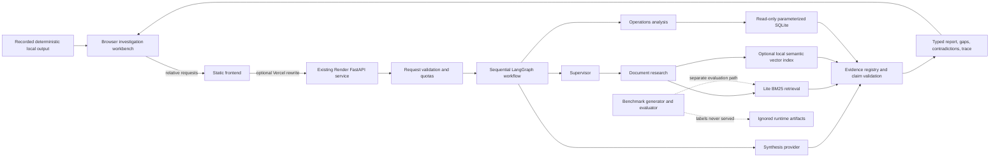

# AEGIS architecture

AEGIS is a bounded evidence-grounded investigation system. It separates retrieval, operational evidence, synthesis, citation validation, and evaluation so that a citation can be inspected without being presented as proof of a production root cause.

## Runtime workflow

1. The browser submits a symptom-oriented question and optional scenario ID.
2. FastAPI validates the request, applies concurrency and quota limits, and starts one bounded investigation.
3. The LangGraph workflow runs sequentially through supervisor, document research, operations analysis, synthesis, and evidence verification.
4. Lite mode uses cached deterministic BM25-style lexical ranking. Standard mode uses Sentence Transformer embeddings with a small local JSON vector index that preserves document IDs and metadata filters.
5. SQLite evidence is read through parameterized tools. Evaluation labels are not loaded by serving code.
6. The evidence registry validates citation identity and applies a conservative lexical claim-support heuristic. This is not semantic entailment.
7. The API returns a typed report with findings, evidence, gaps, contradictions, provider identity, retrieval mode, and a sanitized execution trace.

For backward compatibility, the standard semantic path retains the existing
`retrieval_mode="chroma"` response label even though the implementation no
longer installs or imports ChromaDB.

## Deployment boundaries

- The existing Render URL remains the backward-compatible public application: `https://aegis-ai-y41k.onrender.com/demo/`.
- `frontend/vercel.json` prepares a static frontend deployment with same-origin rewrites to the unchanged Render API.
- Vercel deployment is not performed by this repository and requires confirmation that the selected account and use case satisfy the provider's Hobby terms.
- Benchmark generation and review tooling run locally. They are not part of the serving path.
- `frontend/recorded-demo.json` is an explicitly labeled deterministic local fallback, not live inference.
